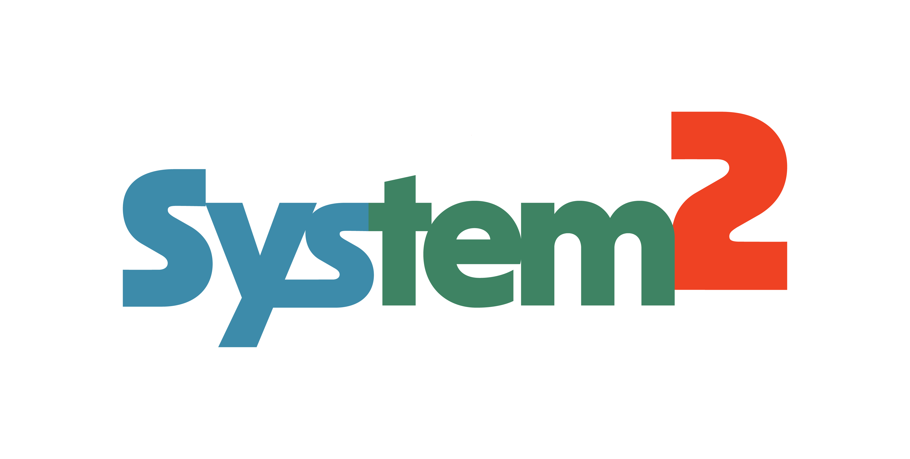

<p align="center">
  
</p>

<h1 align="center">system2-agent: Sovereign Dual-Process Coding Agent</h1>

<p align="center">
  <em>"Remember, your data lives with you now."</em>
</p>

<p align="center">
  <a href="LICENSE"></a>
  <a href="https://github.com/system2-labs/System2"></a>
  <a href="https://huggingface.co/System2-Online"></a>
  <a href="https://github.com/system2-labs/system2-agent"></a>
</p>

---

## What is system2-agent?

**`system2-agent`** is a sovereign, dual-process autonomous coding agent engineered to run frontier-grade software engineering tasks on local consumer hardware (16 GB RAM laptops) with **$0 marginal token cost and 100% air-gapped data privacy**.

Forked from the minimal, extensible [`pi`](https://github.com/earendil-works/pi) architecture, `system2-agent` transforms local quantized open-weights into reliable software engineers by decoupling reasoning from token-by-token text generation:

$$\text{Output} = \text{System 2}_{\text{Sandbox}}(\text{System 1}_{\text{Perception}}(\text{Local LLM}(\text{Prompt})))$$

1. **System 1 (Perceptual Triage & Fast Routing)**: Sub-millisecond domain routing (<0.1 ms) across 13 specialized tracks via ModernBERT, routing tasks to the optimal local or cloud model.
2. **The Regime 2 Protocol**: Automatically strips internal chain-of-thought (`thinkingLevel: "off"`) on 2-bit and 3-bit quantized models, completely preventing token-noise degradation and infinite loop collapse.
3. **System 2 (Deterministic Verification & Self-Healing)**: An external supervisory harness that intercepts tool calls (`bash`, `write`, `edit`), runs automated unit test suites (`pytest`), inspects error tracebacks, and drives closed-loop self-healing refactors until tests pass green.

---

## The Subagent Persona Roster

`system2-agent` divides cognitive labor across four specialized subagent personas with scoped toolkits and dedicated model routing:

```
┌────────────────────────────────────────────────────────────────────────────────────────┐
│                        SYSTEM2 SPECIALIZED SUBAGENT ROSTER                             │
└────────────────────────────────────────────────────────────────────────────────────────┘
       │                           │                          │                     │
       ▼                           ▼                          ▼                     ▼
 ┌───────────┐               ┌───────────┐              ┌───────────┐         ┌───────────┐
 │1. Wanderer│               │2.Philosoph│              │3. Arbiter │         │4.Archivist│
 └───────────┘               └───────────┘              └───────────┘         └───────────┘
 • Codebase Search           • Reasoning & Synthesis    • Verification & Guard• Library & Schemas
 • Model: 27B-smoll (6.9G)   • Model: 27B-iq3 (10.4G)   • ModernBERT + Pytest • Nomic + Gemma 12B
 • thinking: OFF             • thinking: OFF (Regime 2) • Deterministic       • <5ms Local RAG
```

| # | Persona | Primary Task | Model Assigned | Thinking Level | Scoped Tools |
| :---: | :--- | :--- | :--- | :---: | :--- |
| **1** | **Wanderer** | Fast file search, grep, symbol discovery, globbing | `qwen-3.8-27b-smoll` (6.9 GB) | **OFF** | `read`, `grep`, `find`, `ls` |
| **2** | **Philosopher** | Architectural design, bug diagnosis, code synthesis | `qwen-3.8-27b-intermediate` (10.4 GB) | **OFF (Regime 2)** | `read`, `write`, `edit` |
| **3** | **Arbiter** | Pre-execution safety guard, `pytest` runner, AST checks | ModernBERT (143 MB) + `pytest` | **Deterministic** | `bash`, `terminal`, `sandbox` |
| **4** | **Archivist** | Offline library docs, API signatures, framework schemas | Nomic Embed + `gemma-4-12b` | **OFF** | `doc_search`, `cache_read` |

---

## Empirical Benchmark: 27/27 Tests & 10/10 Claude Audit

In benchmark testing against a real-world asynchronous systems engineering task (architecting an in-memory Pub/Sub event bus with typed subscriptions, priority ordering, and error isolation):

1. **Zero-Shot Synthesis**: A local 3.06 bpw model (`Qwen3.8-27B-UD-IQ3_XXS`, 10.4 GB VRAM) running via `system2-agent` synthesized `event_bus.py` (126 lines) and `test_event_bus.py` (229 lines), achieving **22/22 passing tests in 0.05s**.
2. **Adversarial Audit**: The raw code was submitted to **Claude 3.7 Sonnet** for an independent code review, scoring **8.5 / 10** with 4 detailed critique items (an async callable edge case, missing decorator syntax, untested `BaseException` propagation, and weak concurrency interleaving).
3. **Autonomous Self-Healing**: Fed Claude's exact critique, `system2-agent` diagnosed the issues, implemented the call-then-check pattern (`inspect.isawaitable`), added Flask-style decorators, wrote 5 new tests (including `asyncio.CancelledError`), and achieved **27 / 27 passing tests (100%) in 0.02 seconds**, elevating its code grade to **10 / 10**.

---

## Live Terminal Telemetry

`system2-agent` surfaces real-time cognitive and verification state directly in your terminal using official System2 24-bit TrueColor ANSI escapes:

```
[System 1] Track: code (90% conf, lexical) → lmstudio/qwen-3.8-27b-intermediate@iq3_xxs (thinking: off)
[System 2 Guard] Verified bash execution: PASSED
[System 2 Guard] Pytest Suite: 27 passed, 0 failed in 0.02s
```

- **`[System 1]`**: Displayed in official **Steel Blue (`#3d8baa`)** for perceptual triage and domain routing.
- **`[System 2 Guard]`**: Displayed in official **Forest Emerald (`#3e8363`)** for verified tool passes, and **Coral Red (`#ef4223`)** for blocked unsafe commands.

---

## Quickstart & Installation

### 1. Build from Source

```bash
# Clone the repository:
git clone https://github.com/system2-labs/system2-agent.git
cd system2-agent

# Install dependencies and build monorepo:
npm install
npm run build

# Link binary globally (creates `pi-system2` command):
npm link --prefix packages/coding-agent
```

### 2. Set Up Local Inference (LM Studio / llama.cpp)

1. Download our verified Unsloth Dynamic (UD) GGUFs from [Hugging Face (`System2-Online`)](https://huggingface.co/System2-Online/Qwen3.8-27B-DualProcess-GGUF):
   - `Qwen3.8-27B-UD-IQ3_XXS.gguf` (10.4 GB — Primary coding model)
   - `Qwen3.8-27B-UD-IQ2_XXS.gguf` (6.9 GB — Fast Wanderer search tier)
2. Start the local inference server at `http://127.0.0.1:1234/v1`.

### 3. Run system2-agent

```bash
# Interactive TUI mode with local sovereign routing:
pi-system2 --model system2/local

# Headless autonomous execution (runs tests, inspects tracebacks, self-heals):
pi-system2 --model system2/local -p "
Architect a thread-safe and async-compatible Token Bucket rate limiter in Python.
Run pytest test_rate_limiter.py autonomously and resolve any failures.
"

# Automatic hybrid routing (local for code, cloud burst for complex math/logic):
pi-system2 --model system2/auto
```

---

## Dual Form-Factor: CLI & Desktop

`system2-agent` operates as a unified engine across two form factors:
- **CLI (`pi-system2`)**: Interactive terminal TUI and headless one-liner execution for tmux, zsh, and CI/CD pipelines.
- **Desktop (`System2 Desktop`)**: Native GUI (Tauri v2 + Rust) communicating with `system2-agent --mode rpc` over streaming JSON-RPC, featuring full-duplex voice interaction (Parakeet-TDT STT + Kokoro-82M TTS) and one-click Modal cloud compute burst.

---

## License & Heritage

- Licensed under the **[MIT License](LICENSE)**.
- Forked from [`earendil-works/pi`](https://github.com/earendil-works/pi) by Mario Zechner.
- Dual-Process System 1 & System 2 Architecture by [System2 Labs](https://github.com/system2-labs).

---

## Citation & Contact

- **Organization**: [System2-Online](https://huggingface.co/System2-Online)
- **GitHub**: [system2-labs/system2-agent](https://github.com/system2-labs/system2-agent)
- **Web**: [system2.online](https://system2.online)

```bibtex
@software{system2_agent_2026,
  author = {Thom James-Worrall},
  title = {system2-agent: Sovereign Dual-Process Autonomous Coding Agent},
  year = {2026},
  url = {https://github.com/system2-labs/system2-agent}
}
```
