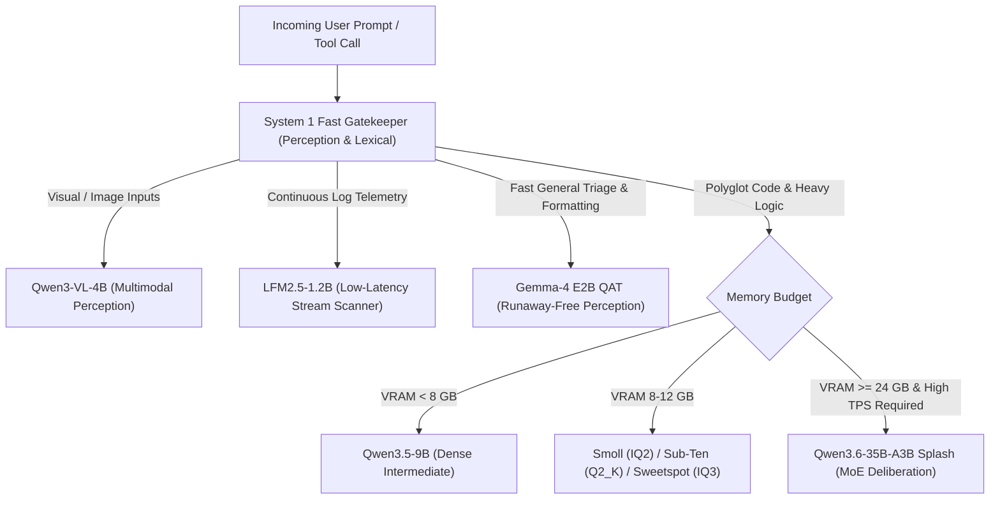

# System 2 Specialized Model Roster & Cognitive Division of Labor

This document formalizes the operational division of labor and specialized functional roles for local models running under LM Studio / Apple Silicon MPS in Pi System 2.

---

## 1. Primary Cognitive & Coding Workhorses

| Model | Footprint | Architecture | Quantization | Primary Functional Role |
| :--- | :---: | :---: | :---: | :--- |
| **Smoll** | 7.27 GB | `qwen35` (Dense 27B) | `IQ2_XXS` | **Ultra-Dense Code Generation (Regime 2)** High syntactic code density. Strictly paired with `thinkingLevel: "off"` to bypass 2-bit quantization noise, backed by external AST invariant guards. |
| **Sub-Ten** | 9.83 GB | `qwen35` (Dense 27B) | `Q2_K_XL` | **Sub-10GB Heavy Reasoning** Fits within base 16GB unified memory laptops. Sits right below the 10GB threshold with block-grouped K-quants. |
| **Sweetspot** | 10.93 GB | `qwen35` (Dense 27B) | `IQ3_XXS` | **Empirical Pareto Frontier** The benchmark sweetspot where perplexity loss plateaus. Used for complex multi-turn code refactoring and algorithmic synthesis. |
| **Splash / A3B** | 20.95 GB | `qwen3_5_moe` (MoE 35B) | `Q4_K_M` (3B active) | **High-Throughput Deliberation Worker** Evaluates tokens with the FLOP latency of a 3B model while retaining 35B MoE capacity. Never quantize below 4-bit to prevent router collapse. |

---

## 2. Specialized Smaller Candidates & Perception Tiers

| Candidate | Footprint | Target ID | Specialized Purpose in System 2 |
| :--- | :---: | :--- | :--- |
| **1. Gemma-4 E2B** | ~1.8 GB | `google/gemma-4-E2B-it-qat-q4_0-gguf` | **Fast Perception, Triage & Syntax Gatekeeper** Pre-trained with Quantization-Aware Training (QAT). Completely eliminates runaway `<think>` loops; ideal for instantaneous tool argument formatting and triage routing. |
| **2. Qwen3.5-9B** | ~6.2 GB | `mradermacher/DeepSeek-V4-Pro-Qwen3.5-9B` | **Intermediate Dense Coding & Logic Tier** Dense 9B architecture at 4-bit precision. Serves as the fallback code synthesis engine when 27B models cannot be loaded due to memory contention. |
| **3. Qwen3-VL-4B** | ~3.3 GB | `Qwen/Qwen3-VL-4B-Instruct-GGUF` | **Multimodal Vision & UI State Perception** Vision-language specialist for inspecting screenshots, terminal graphs, and UI regression artifacts without invoking cloud APIs. |
| **4. LFM2.5-1.2B** | ~1.2 GB | `LiquidAI/LFM2.5-1.2B-Instruct-GGUF` | **Real-Time Log Ingestion & Continuous Telemetry** Liquid Foundation Model (non-transformer/state-space). Sub-2GB memory footprint with near-zero KV cache scaling, tailored for continuous background log streaming and safety anomaly detection. |

---

## 3. Dynamic Routing Rules (`virtual-model.ts`)

